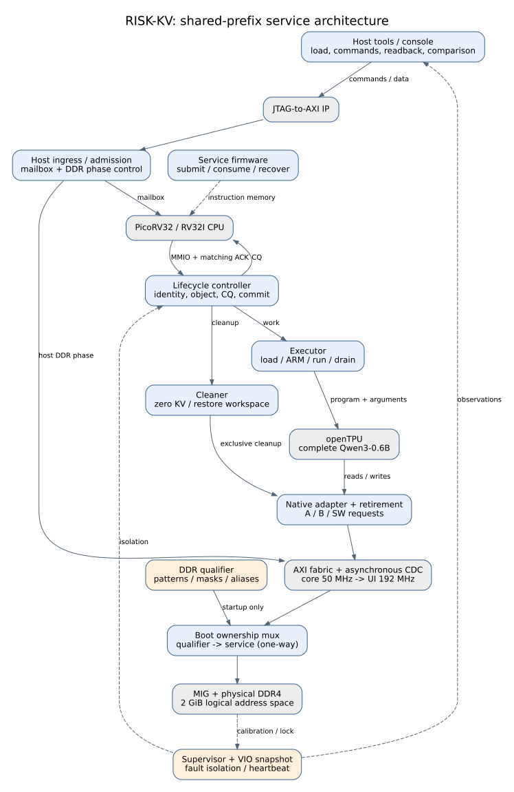

# RISK-KV

**面向共享前缀推理的 RISC-V 与硬件协同 KV 生命周期管理。**

RISK-KV 将前缀构建、封存、查询绑定、任务提交、取消与回收组织为设备侧可验证的服务协议。项目复用 PicoRV32 与 openTPU，以完整 Qwen3-0.6B 为计算负载，面向 VU440 与真实 DDR 实现持续服务。

核心问题是：共享资料被反复查询、任务可能中途取消时，如何减少重复构建，并保证失败任务留下的物理写入不会影响后续服务？



## 当前版本

本仓库为 **2026-11-07 固化协作版**，实验配置标识为 `M1-experimental-demo`。

| 验证层级 | 已取得的结果 |
| --- | --- |
| 完整模型 RTL 仿真 | 64次冷构建、256-token前缀、两组双查询各三步续算及中间清理；有效KV、全部logits和不可变区与参考一致 |
| 独立 DDR 实物 | 10次配置级冷启动、完整2 GiB读写、112轮持续压力（1837.498秒）、84处独立主机读回 |
| 完整 NPU＋MIG 整机 | 最新实现与待完成验收见 [当前状态](docs/status.md) |
| 应用形态 | 固定负载的KV管理演示台；完整资料问答列入下一阶段 |

## 设计贡献

1. **消费后提交的生命周期协议。** 计算完成、存储退休、完成可见和身份匹配消费分别定义；逻辑进度仅在成功消费时推进。
2. **具有退休依据的安全回收。** 取消后的物理写入通过排空、整区清理、工作区恢复和缓存失效处理；失联进入持久隔离。
3. **RISC-V与硬件职责分离。** 固件组织操作流程，硬件控制器维护对象、身份及回收资格，计算模块执行完整模型。
4. **可追溯的实现与验证体系。** 同源布局、独立连续布局参考、定向协议测试、完整模型仿真和真实DDR检查共同支撑系统评价。

研究定位、已有工作和待检验假设见 [贡献与相关工作](docs/research.md)。

## 阅读与协作入口

| 目的 | 文档 |
| --- | --- |
| 理解系统、接口与关键时序 | [架构说明](docs/architecture.md) · [协议合同](docs/m1/contract.md) |
| 撰写技术报告 | [报告材料索引](docs/report-guide.md) · [图源与导出图](docs/figures/README.md) |
| 核对成果与设计取舍 | [里程碑](docs/milestones.md) · [设计决策](docs/decisions.md) · [证据清单](evidence/README.md) |
| 构建、验证与上板 | [复现指南](docs/reproduce.md) · [当前状态](docs/status.md) |
| 组织实物展示 | [展示与验收](docs/demo.md) |
| 开展后续研究 | [应用与路线](docs/roadmap.md) · [贡献指南](CONTRIBUTING.md) |

## 目录

- `rtl/m1/`：当前生命周期控制器、执行器、清理器及服务系统。
- `platform/m1/`：native→AXI、主机控制、CDC/复位、监督器及VU440整机。
- `firmware/m1/`：RV32I邮箱服务固件。
- `tools/m1/`、`scripts/m1`：参考构建、验证、主机与演示入口。
- `tb/m1/`：当前模块与平台验证夹具。
- `configs/m1/`：布局、ABI、主机寄存器与平台配置。
- `vendor/`：固定提交的第三方源码，保留许可证与必要依赖。
- `assets/`：冻结负载、小型程序/参考和固件；大数据获取见复现指南。
- `docs/`、`evidence/`：正式说明、图源和精选里程碑记录。

根目录旧ABI源码与`tb/full_model`用于冻结基线和参考工具依赖；新开发入口为`rtl/m1`。本仓库不包含工作区的逐轮构建目录、工具安装包、凭据、服务器配置或生成的厂商IP实现缓存。

## 快速检查

Python 3.11以上用于主机工具，NumPy版本按依赖锁定。编译器与Vivado版本见复现指南。

```bash
python3 tools/release/verify_snapshot.py
M1_PYTHON=python3 ./scripts/m1 generate_layout --check
M1_PYTHON=python3 ./scripts/m1 generate_host_control --check
M1_PYTHON=python3 ./scripts/m1 board_transport_test --output build/transport-test
```

第三方许可与项目原创部分的使用条款见 [THIRD_PARTY.md](THIRD_PARTY.md)。
