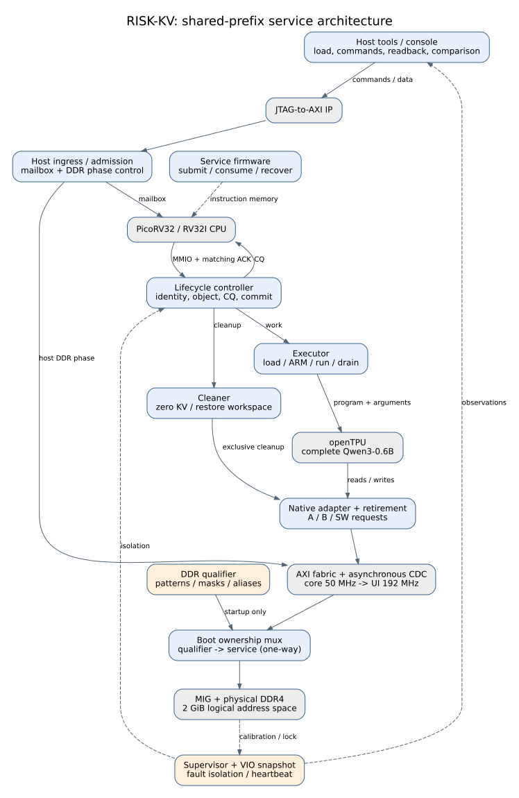
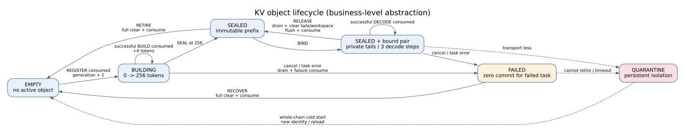
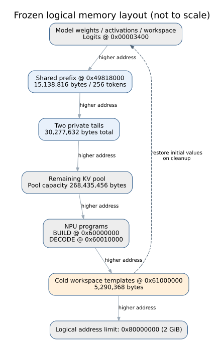

# 系统架构与状态归属

## 系统边界

当前服务配置为完整Qwen3-0.6B、28层、原生INT8权重与激活/KV尺度，一个对象、一个在途计算任务、256-token共享前缀、两个查询及每查询三步续算。PicoRV32为RV32I控制处理器，openTPU承担模型计算。控制/core与fast域为同源50/100 MHz，DDR用户域约192 MHz。



图1为源码级职责图，省略逐位总线。蓝色为项目控制/适配模块，灰色为复用组件，橙色为验证与观察路径。图中箭头表示命令、数据或状态通道，具体信号以源文件为准。

## 状态所有者

| 状态 | 唯一所有者 | 更新依据 |
| --- | --- | --- |
| session、epoch、sequence、generation、对象、绑定、CQ、逻辑进度 | `rkv_m1_control` | 命令接收、匹配消费和受控恢复 |
| 程序装载、ARM/RUN、结果收集 | `rkv_m1_executor` | 装载握手、NPU结束与退休屏障 |
| 清理范围、复制数据、清理计数 | `rkv_m1_cleaner` | 请求接收、响应退休及缓存失效应答 |
| native预取/写聚合与在途责任 | `rkv_m1_native_memory`、`rkv_m1_native_retirement`及平台桥接 | 实际读写接收、返回、退休 |
| 主机请求责任 | `rkv_m1_host_ingress`、`rkv_m1_host_ddr` | 请求接收后保持至完成或隔离 |
| 时钟健康与持久隔离 | `rkv_m1_clock_guard`及监督路径 | 失锁、校准撤回、协议错误与超时 |
| 启动DDR检查/正常服务归属 | `rkv_m1_boot_mux` | 检查成功且完全排空后单向移交 |

CPU复位不清除存储在途责任。整链冷启动重新建立运行身份，作废既有镜像资格并要求完整装载校验。

## 生命周期



图2是业务生命周期抽象，绑定状态与对象状态分开实现；`QUARANTINE`为监督执行状态，不是第五种对象编码。实际对象编码为EMPTY、BUILDING、SEALED、FAILED。

REGISTER建立新代际。每次BUILD成功消费增加4 token，64次后允许SEAL。BIND建立固定双查询引用；DECODE成功消费推进一步。RELEASE清理双尾与工作区、保留前缀，允许再次绑定。RETIRE和RECOVER清理整对象与工作区；消费后进入EMPTY。

## 四个事务边界

```mermaid
sequenceDiagram
 participant CPU as RISC-V / MMIO
 participant C as Lifecycle controller
 participant N as Executor / openTPU
 participant M as Memory / retirement
 CPU->>C: cmd_valid && cmd_ready: capture identity
 C->>N: Work request and eight runtime arguments
 N->>M: Native reads / writes
 M-->>N: Responses and retirement
 N-->>C: Result after HALT and drain
 C-->>CPU: CQ visible; logical progress unchanged
 CPU->>C: Matching completion ACK
 C->>C: Commit successful BUILD / DECODE
```

1. 接收沿冻结session/epoch/sequence/context/generation与运行参数。
2. DDR写入实际退休后，结果具备后续读取可见性。
3. CQ发布后保持稳定，等待软件读回与消费。
4. 身份匹配的成功消费沿推进逻辑状态。取消或错误任务增量为零。

同沿优先级、身份耗尽和完整清理条件见[协议合同](m1/contract.md)。

## 地址布局与清理



图3由`configs/m1/layout.json`生成关键地址标签，区域长度按实际字节列出，图形不按比例绘制。2 GiB为逻辑地址空间，内存实物组织采用当前实验配置。

| 项目 | 字节数 |
| --- | ---: |
| 共享前缀 | 15,138,816 |
| 两个私有尾部 | 30,277,632 |
| 整对象 | 45,416,448 |
| 工作区恢复模板 | 5,290,368 |
| RELEASE写入量 | 35,568,000 |
| RETIRE/RECOVER写入量 | 50,706,816 |

清理器每次只保持一笔128-byte请求；模板恢复先读后写，另产生5,290,368 B读取。以上为布局推导的请求量，板级时延由实测确定。非零工作区恢复初值；缓存失效和连续空闲屏障共同决定复用资格。

## 板级接入

48 MHz差分输入只经过一个IBUFDS，分别驱动MIG内部MMCM和计算时钟MMCM。MIG为M=20、D=1、VCO=960 MHz、相关输出分频5；计算域50/100 MHz经正规AXI CDC连接DDR域。

启动测试器是初始DDR独占主机。测试、peek及存储通道全部排空后，boot mux单向转入正常服务。JTAG主机通过独立控制窗口和DDR准入路径访问，禁止装载期间并发计算。VIO提供核心域序号快照及独立DDR域状态；跨域采样不合并成同一时刻。

## 图与源码对应

图源、来源摘要和可编辑导出见[图件索引](figures/README.md)。图为技术报告的系统抽象；模块端口、状态更新及周期合同分别由RTL、协议文档和验证记录支撑。
