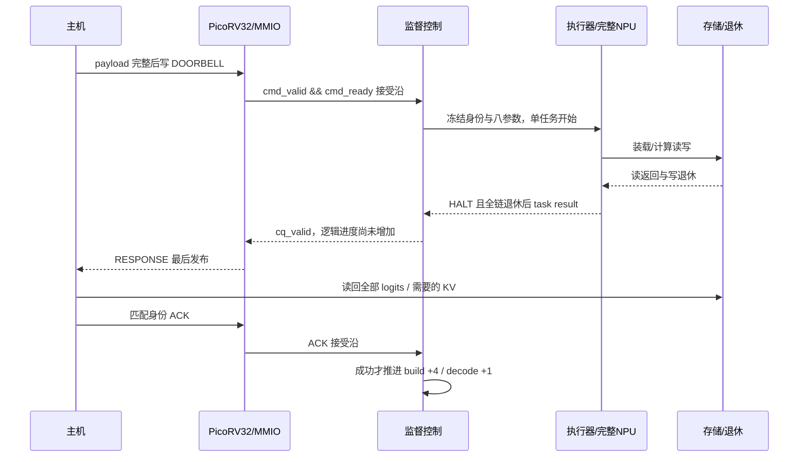

# M1 状态、时序与复位域

本说明对应当前源码。系统框图与源文件映射见[架构说明](../architecture.md)。

## 状态所有者

| 状态 | 所有者 | 推进条件 | 普通复位影响 |
|---|---|---|---|
| session/epoch/seq/generation，对象、绑定、CQ、进度 | service.control | 命令接受冻结身份；成功且匹配的 CQ 消费提交进度 | 监督器不接 CPU reset；受控复位排空清理后推进 epoch |
| 程序种类、装载、ARM/RUN、两字结果 | service.executor | loader busy 起落、固定 ARM、NPU HALT 与真实排空 | 任务 reset 停计算，不能清 DDR 队列 |
| 清理范围、复制数据、接受/退休数、隔离 | service.cleaner | 请求握手、实际响应、失效应答 | 只接整机 cold_reset |
| A/B/SW 选择、清理请求/响应缓存 | system.memory_arbiter | NPU 停止、装载空闲、两拍退休屏障 | 只接 cold_reset |
| 原生预取/聚合/FIFO | native_memory.adapter | 原生命令、数据与有序返回 | 只接 cold_reset，运行切换只失效缓存 |
| 各通道读命令/返回、写命令/数据/退休 | native_memory.retirement | 实际原生接受/退休沿，16-bit 退休增量扩到 64-bit | 只接 cold_reset |
| CPU 寄存器、MMIO 暂存 | cpu.cpu / cpu.mmio | RV32I 指令与原生总线响应 | 受控 CPU reset 清执行状态；启动 RAM/邮箱保留 |
| DDR 物理队列、CDC、主机传输 | 平台MIG、CDC及主机适配层 | 真实内存控制器合同 | 必须独立于 CPU/任务 reset |

## 成功计算的四个边界

这里 NPU 结果写回的接受沿、存储实际可见、CQ 发布和 CQ 消费是不同事件。MMIO 是 PicoRV32 原生总线，`bus_valid && !bus_ready` 接收一次；它不是 AXI-Lite。忙时再写 COMMAND 返回拒绝，不能再次启动任务。CQ 等待期间内容稳定；错误 ACK 不清 CQ，正确 ACK 可随后重试。

控制器命令接受后进入 WORK_REQUEST，保持 work_valid 至执行器接受。程序类型变化才重新装载；装载须看到 busy 的有效起落，再经 ARM 后释放 NPU reset。结果两字写回先收集，NPU HALT、装载空闲、fabric_idle 当前与前拍均成立后，执行器给出完成。外部可无限阻塞，因此合同不承诺有限端到端延迟。

## 释放、恢复和复位

RELEASE 在计算完全退休后进入清理，写零两个私有尾部，按冷模板恢复共享工作区，最后缓存失效与全链空闲。清理完成先形成 CQ，匹配消费才解除绑定；重绑时 decode_steps=0，封存前缀保留。

RETIRE 和 RECOVER 使用整对象清理，消费后对象 EMPTY；REGISTER 消费时 generation+1。正常失败任务允许已发生物理写，但消费时不增加任何进度。失败后不能 SEAL/BIND，必须 RECOVER。

受控复位在接收沿封锁准入和提交。正在执行的请求仍保持握手，不撤回已呈现的 valid；自然结束和排空后清理整个对象及工作区。随后 epoch+1、seq=1、清会话、CPU reset 单拍。主机重新 BOOT；旧 RAM 门铃由新固件启动丢弃。DDR 和退休计数没有跟 CPU 一起清零。

| 同沿事件 | 结果 |
|---|---|
| 成功完成＋有效取消 | 取消结果，增量 0 |
| 错误完成＋取消 | 错误优先，增量 0 |
| CQ 已可见后取消 | 拒绝取消；保持已发布 CQ |
| 正确 ACK＋受控复位 | 不提交；排空并整对象清理 |
| 正确 ACK＋重复/无归属 task result | 当拍阻断提交，隔离；已有最小反例与修复回归 |
| 清理完成＋fabric 错误/无归属响应 | 不能发成功资格，隔离 |
| 超时后迟到响应 | 可计入物理退休，但不能自动解除隔离或复用 |

冷复位是另一种边界：必须全板存储/桥接无旧事务，重新装载完整镜像与模板并使用新 session。首版不恢复跨冷复位会话。

## 固定布局与成本

布局生成源 `configs/m1/layout.json`，生成 RTL package 与 firmware header。2 GiB 地址空间中保持原模型、程序、KV 地址；新增只读冷模板位于 `0x61000000`。双尾清理写入 35,568,000 B（含 5,290,368 B 工作区恢复），整对象清理写入 50,706,816 B；两者另外读取 5,290,368 B 模板。当前一笔清理请求在途，这些是请求量，不是 DDR 带宽或时延测量。

工作区有非零初值，不能全部写零。TMEM/ACT/尺度/偏移的 ISA 动态读前覆盖在当前四-token 构建和三步续算中为 0 次未写先读；完整 RTL 的跨任务数值一致性单独由 G2 检查。该有限证据不推广到任意新程序、格式或上下文长度。

身份耗尽边界的精确说明：当前 RTL 对达到全 1 的 next_sequence 拒绝新命令，对达到全 1 的 generation 拒绝再次 REGISTER，因此身份不会回绕复用；这两种拒绝本身没有置 `isolated`。epoch 已全 1 时受控复位进入隔离。早期合同候选“计数耗尽隔离”的概括过宽，应按这三种实际行为理解；M1 的有限工作负载不触及耗尽边界。统计计数器与身份计数器也不是同一种状态。此处为静态代码核查，未声称运行了 2^32/2^64 次耗尽试验。
